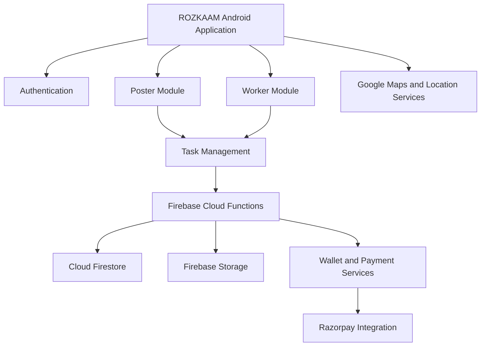

# ROZKAAM – Local Micro-Task Marketplace

**Find help nearby. Get tasks done. Earn on your schedule.**

ROZKAAM is a location-based micro-task marketplace designed to connect people who need small, immediate tasks completed with nearby individuals who are willing to perform them for payment.

The platform supports two user roles: **Poster** and **Worker**. Posters can publish tasks, specify locations, set payments and manage task completion. Workers can discover nearby opportunities, accept tasks, complete assigned work and receive payments through an integrated wallet system.

---

## Table of Contents

- [Overview](#overview)
- [Problem Statement](#problem-statement)
- [Objectives](#objectives)
- [Key Features](#key-features)
- [Application Workflow](#application-workflow)
- [Technology Stack](#technology-stack)
- [System Architecture](#system-architecture)
- [Project Structure](#project-structure)
- [Getting Started](#getting-started)
- [Firebase Configuration](#firebase-configuration)
- [Razorpay Integration](#razorpay-integration)
- [Testing](#testing)
- [Security](#security)
- [Future Enhancements](#future-enhancements)
- [Contributors](#contributors)
- [License](#license)

---

## Overview

ROZKAAM aims to simplify access to short-duration, location-based work opportunities.

Users can post everyday tasks such as:

- Household cleaning
- Gardening and maintenance
- Document pickup and delivery
- Moving and carrying items
- Car washing
- Pet care
- Minor household assistance

Workers can browse available tasks within a selected geographical radius, accept suitable opportunities and complete them for payment.

The application combines location-based discovery, task management, proof submission, payment tracking and user interaction in a single Android platform.

## Problem Statement

Many individuals require assistance with small, immediate tasks but lack a convenient way to find nearby people willing to perform them.

At the same time, students, freelancers and other individuals may be interested in earning money through flexible, short-duration work but often lack access to a centralized platform offering such opportunities.

Existing employment platforms generally focus on long-term jobs, formal recruitment or specialized services.

ROZKAAM addresses this gap by providing a localized marketplace for short-duration tasks, allowing users to connect, coordinate and manage payments through a structured digital platform.

## Objectives

- Develop a centralized platform for posting and discovering micro-tasks.
- Connect task posters with nearby workers using geographical location.
- Provide flexible earning opportunities through short-duration work.
- Implement secure user authentication and profile management.
- Enable task creation, acceptance, tracking and completion.
- Support photographic proof of completed work.
- Introduce task verification using OTP and QR-based mechanisms.
- Implement wallet management and payment tracking.
- Maintain transaction records and task histories.
- Provide a simple and accessible user interface.

## Key Features

### 1. User Authentication and Profiles

- Firebase phone-number authentication using OTP.
- User registration and profile management.
- Separate Poster and Worker modes.
- Role-based application access.

### 2. Task Posting

- Multiple task categories.
- Task title and description.
- Location selection using GPS and maps.
- Immediate or scheduled task options.
- User-defined task payment.
- Wallet-based payment reservation.

### 3. Nearby Task Discovery

- Location-based task discovery.
- Configurable search radius.
- Distance calculation.
- List and map-based task viewing.
- Task details and acceptance.

### 4. Task Management

- Task creation and acceptance.
- Worker assignment.
- Task status tracking.
- Active and completed task histories.
- Task cancellation and applicable refunds.

### 5. Proof of Completion

- Photograph selection and upload.
- Completion description.
- Firebase Storage integration.
- Proof submission and review workflow.
- Task verification using OTP and QR mechanisms.

### 6. Wallet and Payments

- Wallet balance management.
- Available and held balance tracking.
- Razorpay Test Mode integration.
- Payment verification.
- Transaction history.
- Task payment release.
- Withdrawal request management.

### 7. Notifications and Safety

- In-app task notifications.
- SOS functionality.
- User-specific task information.
- Secure access to task-related information.

---

## Application Workflow

### Poster Workflow

1. Register or sign in.
2. Select Poster mode.
3. Create a task.
4. Choose a category and provide task details.
5. Select the task location and schedule.
6. Set the task payment.
7. Publish the task.
8. Review the assigned worker's progress.
9. Review submitted completion proof.
10. Approve the completed task.
11. Release the payment.
12. Provide a rating and feedback.

### Worker Workflow

1. Register or sign in.
2. Select Worker mode.
3. Enable availability.
4. Browse nearby tasks.
5. View task details.
6. Accept a suitable task.
7. Navigate to the task location.
8. Complete the assigned work.
9. Upload photographic proof and a completion description.
10. Complete the applicable task verification.
11. Receive the released payment in the wallet.
12. View earnings and transaction history.

---

## Technology Stack

| Component | Technology |
|---|---|
| Mobile Application | Kotlin |
| UI Development | Jetpack Compose |
| Development Environment | Android Studio |
| Backend | Firebase Cloud Functions |
| Database | Cloud Firestore |
| Authentication | Firebase Authentication |
| File Storage | Firebase Storage |
| Server Runtime | Node.js |
| Backend Language | TypeScript |
| Payments | Razorpay |
| Maps and Location | Google Maps Platform |
| Location Discovery | Geohash |
| Testing | Firebase Emulator Suite, JUnit |
| Version Control | Git and GitHub |

---

## System Architecture

ROZKAAM follows a client-server architecture.

The Android application provides the user interface and communicates with Firebase services for authentication, data management, file storage and backend operations.



### Major Components

- **Android Client:** Handles application screens, user interactions and navigation.
- **Firebase Authentication:** Manages user authentication.
- **Cloud Firestore:** Stores profiles, tasks, wallet information and transaction records.
- **Cloud Functions:** Handles secure backend operations and task lifecycle management.
- **Firebase Storage:** Stores uploaded task completion photographs.
- **Google Maps:** Supports location selection and geographical task discovery.
- **Razorpay:** Supports payment integration and test-mode transaction verification.

---

## Project Structure

The project follows a modular structure separating Android application components and backend services.

```text
ROZKAAM/
│
├── app/
│   ├── src/
│   │   ├── main/
│   │   │   ├── java/
│   │   │   │   └── com/rozkaam/app/
│   │   │   │       ├── data/
│   │   │   │       ├── domain/
│   │   │   │       ├── ui/
│   │   │   │       ├── navigation/
│   │   │   │       └── MainActivity.kt
│   │   │   └── AndroidManifest.xml
│   │   └── test/
│   │
├── functions/
│   ├── src/
│   ├── test/
│   ├── package.json
│   └── tsconfig.json
│
├── docs/
│   └── project-report/
│
├── scripts/
├── firestore.rules
├── firestore.indexes.json
├── storage.rules
├── firebase.json
├── .firebaserc
├── SPEC.md
└── README.md
```

*Note: Directory names may vary depending on the final project implementation.*

---

## Getting Started

### Prerequisites

Install the following tools:

- Android Studio
- Android SDK
- JDK 17
- Node.js 20
- npm
- Firebase CLI
- Git

### 1. Clone the Repository

```bash
git clone https://github.com/YOUR_USERNAME/ROZKAAM.git
```

### 2. Open the Project

Open the cloned project directory in Android Studio.

Allow Gradle to synchronize and download the required dependencies.

### 3. Configure Firebase

Create or access your Firebase project and configure:

- Firebase Authentication
- Cloud Firestore
- Firebase Storage
- Cloud Functions

Add the appropriate `google-services.json` file inside the Android app module.

### 4. Install Firebase CLI

```bash
npm install -g firebase-tools
```

Sign in if required:

```bash
firebase login
```

### 5. Install Backend Dependencies

```bash
cd functions
npm install
```

### 6. Start Firebase Emulators

From the repository root:

```powershell
.\scripts\start-local-emulators.ps1
```

The local emulator environment supports development and testing without modifying production Firebase data.

### 7. Run the Android Application

Open Android Studio, start an Android Emulator and run the application using the Run button.

---

## Firebase Configuration

ROZKAAM uses Firebase services for application data and backend functionality.

| Service | Purpose |
|---|---|
| Authentication | Phone OTP login |
| Firestore | User, task, wallet and transaction data |
| Storage | Completion proof photographs |
| Cloud Functions | Secure task and payment operations |
| Emulator Suite | Local development and testing |

### Local Emulator Ports

| Service | Port |
|---|---:|
| Authentication | 9099 |
| Firestore | 8080 |
| Functions | 5001 |
| Storage | 9199 |
| Emulator UI | 4000 |

**Important:** Configure Android Emulator connections using the host address `10.0.2.2` where required.

---

## Razorpay Integration

ROZKAAM integrates Razorpay for payment processing.

The payment workflow includes:

1. Creating a payment order through a secure backend function.
2. Opening the Razorpay Checkout interface.
3. Verifying payment signatures on the backend.
4. Recording verified payment transactions.
5. Updating the user's wallet balance.

The development environment uses Razorpay Test Mode. Test transactions do not transfer real money.

The wallet escrow mechanism represents an application-level ledger model. It should not be interpreted as regulated escrow custody.

Actual withdrawals require an appropriate payout provider and the necessary business verification.

---

## Testing

The project uses automated testing and local Firebase emulators.

Testing covers:

- Authentication and profile creation.
- Task creation and validation.
- Geohash generation.
- Task acceptance.
- Concurrent task acceptance protection.
- Proof submission.
- Payment verification.
- Wallet transaction integrity.
- Duplicate transaction prevention.
- Firestore and Storage access control.

### Local Development Testing

Use the Firebase Emulator Suite to test backend functionality without affecting production data.

Android unit tests and Cloud Functions tests should be run before each major release.

---

## Security

Security is an important part of ROZKAAM.

The application uses:

- Firebase Authentication.
- Server-side validation.
- Firestore security rules.
- Firebase Storage security rules.
- Role-based access restrictions.
- Atomic Firestore transactions.
- Payment signature verification.
- Duplicate transaction protection.
- Restricted access to task proof photographs.

Wallet balances and transaction records must only be modified through authorized backend operations.

**Never commit API keys, private credentials, `.secret.local`, or local development configuration containing secrets to GitHub.**

---

## Future Enhancements

Potential future improvements include:

- Integration with production payout services.
- Advanced worker recommendation algorithms.
- Improved real-time location tracking.
- Multi-language support.
- Enhanced notification delivery.
- Worker verification and trust scoring.
- Advanced analytics and reporting.
- Expanded service categories.
- Dispute resolution and support mechanisms.

---

## Contributors

**ROZKAAM Development Team**

- Project planning and development
- Android application development
- Backend and Firebase integration
- UI/UX design
- Testing and documentation

---

## License

This project is developed for academic and educational purposes.

Add an appropriate open-source license before permitting external reuse or distribution.

---

**ROZKAAM – Making everyday tasks easier, one connection at a time.**
